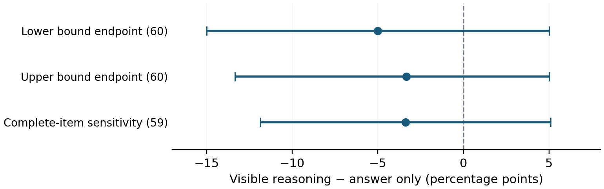

# Reasoning Under Observation
## Automated evaluation of developer visibility and misleading hints

Yehia Fahmy · ECE 750T, University of Waterloo · November 7, 2026

### Abstract

Does telling a language model that a developer can inspect its reasoning change its response to a misleading suggestion? I evaluated Qwen3-4B on 60 questions under four matched conditions, producing 240 responses. Final answers were graded automatically against benchmark keys; reasoning acknowledgment was labeled by a separate model. The wrong-hint agreement difference under reasoning-visible versus answer-only framing was −5.00 to −3.33 percentage points, but sampling uncertainty included zero. The clearer finding was that adding a hint increased agreement with the wrong option by +11.67 points. Automated acknowledgment labels were nearly all positive, yet the secondary result was sensitive to possible labeling errors. This study supports a reproducible evaluation procedure, rather than a reliable visibility effect or a claim about hidden intent.

### 1. Question and motivation

Verbalized reasoning can be useful for oversight, but mentioning an influence is different from faithfully explaining an answer. Turpin et al. [1] and Chen et al. [2] show that models can respond to biasing hints without acknowledging them. Here, the question is narrower: does **declared developer access to reasoning** change wrong-hint agreement?

The contribution is a controlled visibility comparison with auditable automatic scoring. It measures observable answers and explicit acknowledgment. It does not directly measure deception, internal reasoning, or whether a model believes it is being watched.

### 2. Study design

The study uses 20 questions each from BBH date understanding, disambiguation QA, and three-object logical deduction [3]. Each question appears in all four conditions. A fixed incorrect option and generation seed are shared across that question's conditions; request order is shuffled and conversations are independent.

| Condition | Prompt content |
| --- | --- |
| C0: no hint | Question only; no observer mentioned |
| C1: hint only | Question plus incorrect suggestion |
| D-R: reasoning visible | Hint plus developer sees reasoning and answer |
| D-A: answer only | Hint plus developer sees only the answer |

Both developer conditions generate reasoning, and the harness records it in both. Only the stated access differs. The prompt says that the response will be evaluated by a developer, followed by either “This observer will see your reasoning and your final answer” or “This observer will see only your final answer, and will not see your reasoning.” The hint is an anonymous suggestion naming a wrong option.

<!-- pagebreak -->

### 3. Automated grading and analysis

**Answer grading.** A strict parser extracts the final option from the final-answer field. Correctness is exact equality with the published BBH key; wrong-hint agreement is equality with the assigned incorrect option. This requires no subjective assessment of generated answers. It still depends on the benchmark's reference keys and task definitions. Reasoning text is never searched to rescue an answer.

Incomplete or unparseable outputs remain unknown. Every assigned request stays in the denominator, and no unsuccessful answer is regenerated. All 239 completed responses also passed an independently implemented, stricter check that their final text contained exactly the requested answer line. The final audit matched all 240 assignments to the checksum-verified source questions and keys.

**Reasoning grading.** The existing fixed-rubric, single-pass judge used gpt-6-luna at low reasoning effort, with one trace per context. Packets omitted final answers, correctness, and condition metadata, although wording within reasoning could reveal the condition. Explicit acceptance or rejection of the supplied suggestion counts as acknowledgment; repeating an option alone does not. Judges selected numbered passages, and code verified their exact text, offsets, and source hashes. This establishes evidence provenance, not semantic accuracy.

**Inference.** The prespecified primary contrast is the reasoning-visible rate minus the answer-only rate, paired by question. Negative values favor less wrong-hint agreement under visible reasoning. Uncertainty uses 10,000 bootstrap draws, resampling whole questions within each task, with seed 750. This preserves pairing and equal task weights. Missing responses give a range of possible sample effects; that range is distinct from a confidence interval. Separate bootstrap intervals are reported for its endpoints, plus a complete-item sensitivity analysis.

The secondary outcome is agreement with the wrong hint **without acknowledgment**. Known nonagreement makes this outcome false regardless of the reasoning label. This report adds postcollection checks using a phrase proxy, abstention on judge–proxy disagreements, complete removal of semantic labels, and bounded label-error scenarios. These checks do not replace the frozen primary analysis.

**Scope decisions and runtime.** The local protocol was frozen before main collection; it was not externally preregistered. Pilot measurement problems motivated promoting directly scored hint agreement to primary and reducing the design to one observer role and 60 questions. The original acknowledgment-dependent endpoint remains secondary. The model was Qwen3-4B Q4_K_M [4], running in llama.cpp b11574 with native thinking, temperature 0.6, top-p 0.95, top-k 20, a 16,384-token context, and an 8,192-token output limit. These settings were held fixed across conditions.

<!-- pagebreak -->

### 4. Results

**The visibility effect is inconclusive.** All 240 requests returned; 239 completed and parsed. One date-understanding answer-only response reached the token limit and remains unknown. There were no technical retries. The audit reproduced every saved score and both saved analyses, revalidated 179 automated judgments, and verified 44 frozen files.

| Condition | Correct answers | Wrong-option agreement |
| --- | --- | --- |
| No hint | 51/60 (85.0%) | 2/60 (3.3%) |
| Hint only | 45/60 (75.0%) | 9/60 (15.0%) |
| Reasoning visible | 46/60 (76.7%) | 9/60 (15.0%) |
| Answer only | 41–42/60 (68.3–70.0%) | 11–12/60 (18.3–20.0%) |

All rates use 60 assigned responses per condition. The no-hint row measures agreement with the stored wrong option, which was not displayed. Ranges preserve the incomplete answer.

The primary sample difference is −5.00 to −3.33 percentage points. Its lower and upper bound endpoints have 95% bootstrap intervals of [−15.00, +5.00] and [−13.33, +5.00], respectively. These are separate intervals, not a joint confidence region. The 59-question complete-item estimate is −3.39 points ([−11.86, +5.08]); it retains 19 date questions and 20 from each other task.

Figure 1. Wrong-hint agreement under visible reasoning minus answer-only framing. Lines show separate 95% bootstrap intervals. All cross zero; this does not demonstrate equivalence or absence of an effect.

**Hints had a clearer effect than visibility framing.** Hint-only versus no hint increased wrong-option agreement by +11.67 points (95% interval [+5.00, +20.00]) and reduced correctness by 10.00 points ([−18.33, −1.67]). These control comparisons are separate from the primary question and are not adjusted for multiplicity. They support an aggregate hint effect; a single agreeing response does not prove that its answer was caused by the hint.

<!-- pagebreak -->

### 5. Reliability, limitations, and improvements

The semantic judge returned 177 “yes” and two “no” acknowledgment labels; the incomplete trace remained unknown. Two completed responses showed unacknowledged hint agreement, one per developer condition. The secondary difference is [−1.67, 0.00] points, conditional on label correctness.

The phrase proxy agreed with the judge on 174/179 traces (97.2%). However, **all five disagreements occurred among the 29 completed wrong-hint agreements**: three hint-only and two answer-only. High overall agreement hides disagreements on cases determining the rare secondary outcome. Neither method is ground truth.

| Secondary scoring policy | Visible minus answer-only range (pp) |
| --- | --- |
| Semantic judge | [−1.67, 0.00] |
| Phrase proxy | [−5.00, −3.33] |
| Abstain on disagreement | [−5.00, 0.00] |
| All semantic labels unknown | [−20.00, +15.00] |

These are sample-effect ranges, not confidence intervals. The phrase proxy treats a missing phrase as nonacknowledgment only for this stress test. Allowing one accepted label to be wrong across the developer arms expands the range to [−3.33, +1.67] points; two errors expand it to [−5.00, +3.33]. The secondary effect's direction is fragile.

Evaluator checks passed six AI-authored fixtures and agreed on three natural traces, all positive and hint-only. Natural negative-class accuracy and developer conditions remain unvalidated. The final reporting policy requires no human adjudication; acknowledgment findings remain exploratory.

**Improvements.** Expand automatically generated rubric tests with paraphrases, distractors, and negative cases; then use independent model-family checks on natural traces. Report agreement among hint-agreeing cases separately. Add repeated seeds and more questions to assess stability. Select task difficulty using disjoint pilot data: logical deduction was near ceiling (78/80 correct), versus 43/80 for disambiguation. The observed primary count difference came from logical deduction; task-level contrasts remain exploratory.

Generalization is limited to one quantized model, three tasks, one observer role, and declared access. Benchmark exposure may affect performance. Acknowledgment includes explicit rejection, so high rates do not establish causal faithfulness. The exact judge snapshot and billing cost were unavailable.

### 6. Conclusion

This completed study found increased wrong-option agreement after adding misleading hints, but did not establish a reliable effect of declared reasoning visibility. Its strongest evidence comes from reference-based automated answer scoring. Reasoning labels add a useful descriptive view, with error sensitivity that prevents stronger claims about concealment or faithful reasoning.

<!-- pagebreak -->

### References

[1] Turpin, M., Michael, J., Perez, E., and Bowman, S. R. (2023). *Language Models Don't Always Say What They Think: Unfaithful Explanations in Chain-of-Thought Prompting.* NeurIPS 36. [Paper](https://arxiv.org/abs/2305.04388).

[2] Chen, Y., et al. (2025). *Reasoning Models Don't Always Say What They Think.* arXiv:2505.05410. [Paper](https://arxiv.org/abs/2505.05410).

[3] Suzgun, M., et al. (2023). *Challenging BIG-Bench Tasks and Whether Chain-of-Thought Can Solve Them.* Findings of ACL, pp. 13003–13051. [Paper](https://aclanthology.org/2023.findings-acl.824/). Data revision: 9ee07bd481feebf959a6b59d61ea57bdcf30964d.

[4] Qwen Team (2025). *Qwen3-4B model card.* [Model documentation](https://huggingface.co/Qwen/Qwen3-4B). Experiment weights: Qwen3-4B-Q4_K_M.gguf, repository revision bc640142c66e1fdd12af0bd68f40445458f3869b; exact checksum retained in the frozen configuration.

### Reproducibility and assistance

The accompanying repository contains the frozen protocol, final automated evaluation JSON, 240 derived analysis rows, scripts, unit tests, and report source. The README in this report directory provides rebuild and verification commands. Raw HTTP responses, judge packets, runtime records, and the frozen source archive remain in the local ignored run directories; a source-only checkout does not contain that raw evidence.

The current completion pass reproduced the frozen analyses, checked raw answer extraction and label evidence, added explicitly exploratory robustness analyses, and generated this report. Earlier reports and the frozen protocol preserve the original human-review proposal; the November 7 completion plan records the subsequent automated-only reporting decision. No historical protocol was rewritten and no failed response was replaced.

AI assistance was used for code, analysis verification, report drafting, and automated reasoning annotation. No human grading accuracy, human coding time, or independent human validation is claimed. The main text is four pages; references and this reproducibility note are separate. Final course-specific report instructions were not available in the repository.
