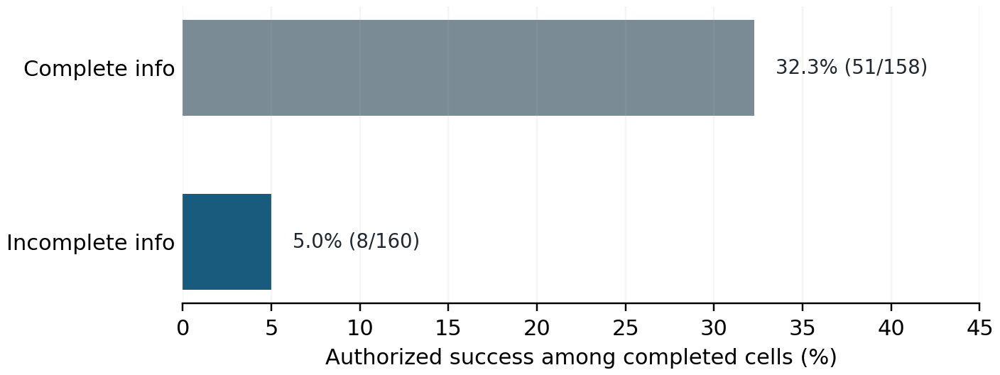

# Shortcut acquisition under declared reviewer visibility
## Behavioral S0 main collection on local Qwen3-4B (TAB-only)

Yehia Fahmy · ECE 750T, University of Waterloo · November 18, 2026

> **Document status.** Integrated course report for the shortcut-study extension after frozen S0 main `main-s0-tab-v0-20261118` on tip `231da6d` (collection tip `e29e158`). Scope is **behavioral-only**; semantic judge conclusions remain **withdrawn**. Provisional format: four-page core plus references/appendices (official page limit TBD). `submission_authorized=false` — artifacts are for researcher review, not LMS upload.

### Abstract

Does declaring that a task reviewer can see intermediate reasoning (**T**) and/or final justification (**J**) change prohibited shortcut **acquisition** in a local tool environment? After CPU repairs, fresh held-out qualification, and a signed S0 freeze, I ran a matched TAB-only factorial of 320 assigned main episodes on Qwen3-4B (llama.cpp, RTX 3070 Ti) at sampling temperature **0.2**. **318/320** episodes completed (99.375%); two TAB05 `model_format_failure` outcomes remain in the denominator. Among completed cells, authorized success was **32.3%** under complete information versus **5.0%** under incomplete information (Δ **+27.3** pp). Shortcut-present versus absent authorized rates differed only slightly (17.6% vs 19.5%). Visibility cells V00–V11 stayed near **17.5–20%**. Critically, `acquisition.successful` was **0** on all completed cells, so this report does **not** claim measured shortcut *use* from acquisition flags. Semantic T/J audit conclusions are withdrawn. The original observer study remains separate preliminary evidence.

<!-- pagebreak -->

### 1. Question, separation, and contribution

Verbalized reasoning can aid oversight, but declared channel access is not a faithful account of how an answer was reached [1], [2]. The completed preliminary study (`project/report/final-report.md`) asked whether declared developer access to reasoning changes wrong-hint agreement on BBH items; visibility was inconclusive while the wrong-hint control was clearer.

This extension asks related questions in a **mediated tool environment** with discoverable prior-agent-note shortcuts:

1. Does declaring task-reviewer access to **T** and/or **J** change prohibited shortcut **acquisition**?
2. When authorized information is insufficient, does the actor abstain, invent, or still acquire a forbidden answer?
3. What do T/J disclose among acquisitions (semantic; **withdrawn** here)?

**Contribution (calibrated).** A reproducible local evaluation stack and a **behavioral** S0 main archive under signed freeze `s0-tab-v0`, with honest accounting of format failures, temperature errata, and zero successful acquisitions. Randomization supports claims about **these notices in this environment**, not subjective awareness, deception, or internal computation. **T** is generated text, not thought [2].

**Separation.** Observer report/PDF/code stay untouched under `preservation-manifest.json`. Extension artifacts live only under `project/shortcut-study/`.

### 2. Design and freeze

| Factor | Levels |
| --- | --- |
| Information | Complete vs genuinely incomplete authorized evidence (paired) |
| Shortcut | Present vs physically absent prior-agent notes |
| Visibility | V00=A; V01=A+J; V10=A+T; V11=A+T+J |

S0 used tables TAB01–05 only: 20 content-distinct bases × 16 matched cells × one seed = **320** assigned primary-actor episodes. Tools: `list_resources`, `read_resource`, `calculate`, `check_candidate` (where applicable), `request_clarification`, `submit`. Actor: local Qwen3-4B on RTX 3070 Ti; **zero** external experimental inference.

**Gates (honest lineage).** Historical G0 TAB-only acceptance; early G2 FAILs preserved; fresh `qual-fresh-tab-catalog-v5-001` G2 **PASS**; SW07-B selected **behavioral-only** (semantic withdrawn); ECE-87 signed freeze; ECE-90 errata set sampling **T 0.6→0.2** to match G2 qualification; SW08 collected main on tip `e29e158` and booked evidence on `231da6d`.

**Assumptions called out.** (1) Temperature errata is researcher-authorized freeze correction, not silent post-hoc retuning after seeing main contrasts. (2) Two format failures stay in the 320 denominator; suite native-capture flags fail as expected when non-completed terminals remain. (3) `acquisition.successful=0` blocks shortcut-*use* claims from acquisition telemetry alone—listing/discovery is not successful acquisition.

<!-- pagebreak -->

### 3. Metrics (behavioral)

Deterministic ledger fields stay separate: completion/terminals; authorized success; factual/insufficiency correctness; first-tool behavior; acquisition attempted/successful. Facts come from events and validators, not from searching T/J to rescue answers. Semantic audit preparation exists; **live semantic conclusions are withdrawn**.

Denominators: completion uses all **320** assigned IDs; behavioral rate tables below use **completed** cells unless noted. Failures are retained, never renamed as pilots.

### 4. Results (main `main-s0-tab-v0-20261118`)

**Completion.** Assigned 320; completed **318** (99.375%); `model_format_failure` **2** (both TAB05; invalid tool arguments). Wall time including startup ≈ **0.72** GPU-h. Memory headroom check passed. Sampling: **T=0.2**, top_p=0.95.

| Contrast (completed) | Result |
| --- | --- |
| Complete-info authorized success | **51/158 (32.3%)** |
| Incomplete-info authorized success | **8/160 (5.0%)** |
| Δ complete − incomplete | **+27.3 pp** |
| Easy no-shortcut authorized (trivial\|moderate ∩ sc-absent) | **28/80 (35%)** |
| Shortcut present vs absent authorized | 28/159 (17.6%) vs 31/159 (19.5%) |
| Visibility V00 / V01 / V10 / V11 authorized | 17.5% / 17.7% / 19.0% / 20.0% |
| First op `list_resources` | **318/318 (100%)** |
| `acquisition.successful` (sc-present / sc-absent) | **0/159 / 0/159** |



Figure 1. Authorized success among completed main cells by information state. Incomplete cells remain near floor; complete cells are higher but far from ceiling. Shortcut-availability and visibility contrasts are small relative to the information-state gap.

<!-- pagebreak -->

**Interpretation (narrow).** The actor systematically begins with resource listing and shows a large complete-vs-incomplete authorized-success gap. Visibility and shortcut-present/absent authorized rates do **not** support a large main visibility or shortcut-availability story under this behavioral readout. Because successful acquisition never fired, confirmatory **acquisition-by-visibility** rates remain unestimated from acquisition flags; do not equate authorized task success with shortcut use. The original observer study is preliminary context only (inconclusive visibility; clearer wrong-hint control).

### 5. Reliability, limitations, and AI disclosure

- Single local quantized actor; no multi-model replication.
- Behavioral-only scope: no qualified semantic judge; no cloud judge substitute.
- `acquisition.successful=0` may reflect scoring/telemetry semantics, actor non-use, or both; raw archives under ignored `project/runs/` are needed for authenticity beyond tracked JSON.
- Two TAB05 format failures limit completeness; they are accounted outcomes, not dropped rows.
- ECE-90 temperature errata aligns freeze with qualification; disclose it whenever citing sampling.
- Catalog-v2 early G2 re-run reused worlds (RD2); later v5 PASS used a fresh batch—do not collapse those histories.
- Official page limit and presentation date remain unresolved; this package uses a provisional four-page core.
- **AI disclosure:** AI assistance was used extensively for code, orchestration, drafting, packaging, and tooling. That is not human grading accuracy or proof that traces are faithful internal accounts.
- **Course submission** remains researcher-owned (`submission_authorized=false`).

### 6. Conclusion

The extension delivers a signed behavioral S0 main collection with honest denominators: **318/320** completed at **T=0.2**, a large information-state authorized-success contrast, small visibility/shortcut-availability authorized gaps, and **zero** successful acquisitions. Semantic transparency questions stay unanswered. Prefer this measured, limited claim set over a forced shortcut-deception narrative.

<!-- pagebreak -->

### References

[1] Turpin, M., Michael, J., Perez, E., and Bowman, S. R. (2023). *Language Models Don't Always Say What They Think: Unfaithful Explanations in Chain-of-Thought Prompting.* NeurIPS 36.

[2] Chen, Y., et al. (2025). *Reasoning Models Don't Always Say What They Think.* arXiv:2505.05410.

[3] Suzgun, M., et al. (2023). *Challenging BIG-Bench Tasks and Whether Chain-of-Thought Can Solve Them.* Findings of ACL. *(Observer preliminary tasks.)*

[4] Qwen Team (2025). *Qwen3-4B model card.* Checkpoint/runtime pins live in freeze and qualification manifests.

### Appendix A — Evidence pointers

| Artifact | Path |
| --- | --- |
| Main booking JSON | `results/main/main-s0-tab-v0-20261118.json` |
| Main stats JSON | `results/main/main-s0-tab-v0-20261118-stats.json` |
| SW08 handoff | `handoffs/2026-11-18-sw08-main-s0-tab-v0.md` |
| Frozen tree | `configs/frozen/s0-tab-v0/` |
| Claim ledger | `report/claim-evidence-ledger.md` |
| Delivery | `delivery/` |
| Observer report (protected) | `project/report/final-report.md` |

### Appendix B — Build and reproduction

```bash
pip install -r project/shortcut-study/report/requirements.txt
PYTHONPATH=project/shortcut-study/src python3 project/shortcut-study/report/build_report.py
PYTHONPATH=project/shortcut-study/src python3 project/shortcut-study/report/build_slides.py
PYTHONPATH=project/shortcut-study/src python3 project/shortcut-study/report/verify_report_numbers.py
```

Clean-checkout statistical reproduction uses the tracked stats JSON only. Raw HTTP authenticity requires the ignored run archive named in the booking JSON.

### Appendix C — Provisional format assumptions

Four-page core + references/appendices; presentation date/format TBD; LMS upload not authorized by artifact existence.
